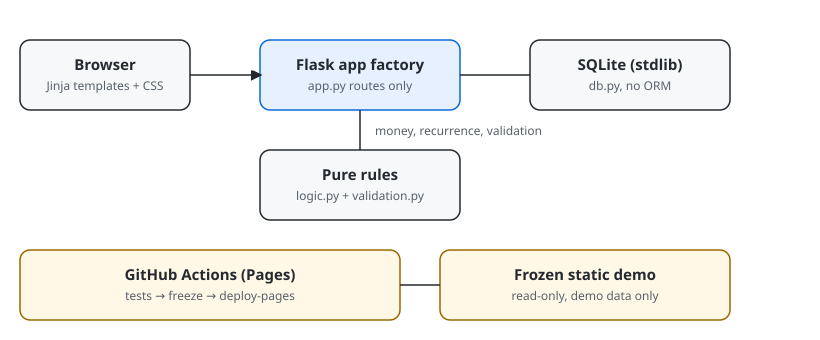

# Landscape Manager

[](https://github.com/enonymous1/landscape-manager/actions/workflows/ci.yml)
[](https://github.com/enonymous1/landscape-manager/actions/workflows/pages.yml)
[](LICENSE)
[](pyproject.toml)

> Badges point at `enonymous1/landscape-manager` and go live on the
> first push — until then they show as unknown. That is expected, not a
> broken link in this repo.

## Description

Landscape Manager is a generalized web app for running a landscaping
business — not tied to one company. It manages clients and their
properties, keeps an editable service catalog, schedules one-off and
recurring jobs, and turns quotes into invoices, all stored locally in
SQLite.

This is a greenfield build from the `ss-sun-n-shade` idea. The original
repo was only a README and an Android `.gitignore` — no code — so
nothing was ported. This version pivots to the web.



### Features

- **Dashboard** — today's jobs, jobs in the next 7 days, overdue jobs,
  and the total of unpaid invoices.
- **Clients and properties** — a client can have several properties;
  jobs, quotes, and invoices link to them.
- **Services** — editable catalog (mowing, mulching, trimming, and so
  on) with a default price and unit.
- **Jobs** — one-off, weekly, every-two-weeks, or monthly. Marking a
  recurring job done can schedule its next occurrence automatically
  (monthly dates clamp to month-end, so Jan 31 recurs to Feb 28).
- **Quotes and invoices** — line items from the catalog or custom
  lines, quantities, totals in integer cents (never floats, so totals
  cannot drift by cents). A quote converts to an invoice (due in
  30 days) with its items copied over; invoices can be marked paid.
- **Settings** — change the business name shown in the header.
- **Theme** — Auto by default (follows your system), with a header
  picker for Light / Dark saved per browser.

Deliberately out of scope for v1: login/multi-user roles, online
payments, and a customer portal. The app is a local, single-user tool;
it has no authentication, so do not expose it to the internet as-is
(see [Deployment](#deployment)).

## Prerequisites

- Python 3.11 or newer (`python --version`)
- `pip` (ships with Python)
- Git, if you want to clone the repo rather than download a zip
- No database server, no Node, no other services: storage is a local
  SQLite file, created on first run

## Installation

```bash
git clone https://github.com/enonymous1/landscape-manager.git
cd landscape-manager
python -m venv .venv
# Windows PowerShell:
.venv\Scripts\Activate.ps1
# macOS / Linux:
source .venv/bin/activate
pip install -e .
```

For development (tests and linting), install the dev extras instead:

```bash
pip install -e ".[dev]"
```

## Local Development

Run the app with fictional demo data (fictional people, addresses, and
`@example.test` emails) — seeded only if the database is empty:

```bash
landscape-manager --demo
# open http://127.0.0.1:5000
```

Without `--demo`, you start with an empty business (the default service
catalog is empty — add services from the Services page first). The
database file defaults to `landscape.db` in the working directory;
override it with `--db path/to/file.db` or the `LANDSCAPE_DB`
environment variable.

Other useful commands:

```bash
landscape-manager --host 127.0.0.1 --port 5000 --db my-business.db
landscape-manager freeze docs   # local preview of the static demo (see below)
python -m pytest -q             # tests
ruff check src tests            # lint
ruff format --check src tests   # format check
```

### Environment variables

| Variable | Purpose | Default |
| --- | --- | --- |
| `LANDSCAPE_DB` | SQLite file path | `landscape.db` |
| `LANDSCAPE_SECRET_KEY` | Flask session secret | Random per process start |

Set `LANDSCAPE_SECRET_KEY` to a stable secret for any deployment
beyond a local demo. Without it, a random key is generated on each
start and sessions (flash messages) do not survive a restart. It is
deliberately not hardcoded: there is no default secret to leak.

### Project layout

- `src/landscape_manager/app.py` — Flask app factory and routes
  (thin layer only; see Architecture below)
- `src/landscape_manager/logic.py` — pure rules: money in integer
  cents, totals, recurrence, overdue, business constants
- `src/landscape_manager/validation.py` — form validation: bad input
  becomes a flashed message, not a 500
- `src/landscape_manager/db.py` — SQLite schema, indexes, and batched
  invoice totals
- `src/landscape_manager/demo.py` — fictional demo seed only
- `src/landscape_manager/freeze.py` — static demo freezer for GitHub
  Pages (demo data only, by construction — it takes no database
  argument, so real data cannot be frozen by mistake)
- `src/landscape_manager/templates/` + `static/` — Jinja pages and CSS
- `tests/` — logic unit tests, route tests, freeze tests, and
  workflow tests (`conftest.py` holds the shared app fixture)
- `.github/workflows/ci.yml` — tests on Python 3.11–3.13
- `.github/workflows/pages.yml` — frozen demo deploy (see Deployment)

### Architecture

The layering is intentional, and the next refactor should preserve it:

1. **Routes** (`app.py`) parse HTTP, validate via `validation.py`,
   and render. They do not compute money or dates.
2. **Pure rules** (`logic.py`) have no Flask, database, or filesystem
   dependency, so they are covered by plain unit tests.
3. **Storage** (`db.py`) is stdlib SQLite, no ORM. Schema changes are
   the known gap: `CREATE TABLE IF NOT EXISTS` does not migrate an
   existing database, so a `PRAGMA user_version` migration step is
   required before the next schema change ships.
4. **Next split, when routes grow again:** blueprints (clients, jobs,
   documents, settings) behind a service layer — not more routes in
   `app.py`, which is already the largest file in the project.

## Deployment

### GitHub Pages demo (read-only, recommended for showcasing)

The live app needs a server, but a read-only demo is generated by CI:
on push to `main`, `.github/workflows/pages.yml` runs the tests,
freezes the demo to `frozen-demo/`, and deploys it with GitHub
Actions. In the repo, set Settings → Pages → Source to
**GitHub Actions** (not `main` / `docs`).

For a local preview of the same output:

```bash
landscape-manager freeze docs
# writes docs/ (28 pages + static assets), then serve that folder
```

`docs/` and `frozen-demo/` are gitignored generated output — never
committed, never hand-edited. The frozen site is browsing-only: a
"Static demo" banner is shown, forms are disabled, and nothing is
saved. Theme switching still works.

### Self-hosting the live app (not yet production-hardened)

The built-in Flask development server (`landscape-manager`) is for
local use only. For a small trusted deployment, run it behind a real
WSGI server (e.g. Waitress on Windows, Gunicorn on Linux), bind it to
localhost or a trusted network only, set `LANDSCAPE_SECRET_KEY`, and
back up `landscape.db` regularly. There is no login, no CSRF tokens,
and no rate limiting yet — those are the three hardening steps before
any internet-facing deployment, and they are tracked as future work,
not silently claimed as done.

## Screenshots and visual assets

The architecture diagram above (`assets/architecture.svg`) is the
only visual shipped in this version, because it is generated from the
actual layering and cannot go stale in the way a screenshot can.

**Recommended assets to add next — in this order, at these places:**

1. **Dashboard screenshot** — `assets/screenshots/dashboard.png`,
   placed directly under the Features list above. Depict: the
   dashboard with demo data, showing today's jobs, the next-7-days
   list, one overdue job, and the unpaid-invoice total. Capture it
   from the frozen demo (run `landscape-manager freeze docs` and
   screenshot the served page), never from a hand-made mock.
2. **Jobs and quote walkthrough GIF** — `assets/demo-walkthrough.gif`,
   placed at the end of the Local Development section. Depict, in
   order: create a client, add a property, schedule a weekly job, mark
   it done with reschedule checked, then convert a quote to an
   invoice. Keep it under 30 seconds and under 2 MB.
3. **Data-model diagram** — `assets/data-model.svg`, placed in the
   Architecture section. Depict: clients → properties → jobs, and
   clients → quotes/invoices → line items, with the foreign keys
   labelled. Generate it from `db.py`'s schema, not by hand-drawing
   tables that may not match the code.

Do not add placeholder images with broken links, and do not fake
screenshots: every visual in this README should be capturable from
the running app or generated from its code.

## Tests

```bash
pip install -e ".[dev]"
python -m pytest -q
```

CI runs the same tests on Python 3.11, 3.12, and 3.13, plus ruff
check and format checks, and a freeze smoke test.
